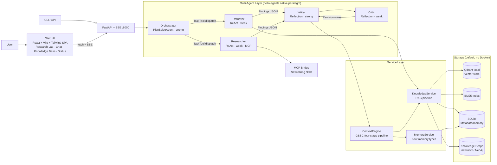
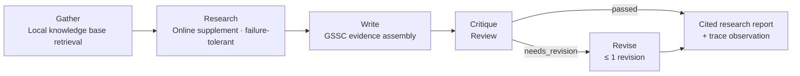

# Cortex

A multi-agent personal knowledge management & research assistant built on Datawhale's `hello-agents` framework (v1.0.0). Transform scattered local documents into a searchable, question-answerable private knowledge base, then produce fully-cited research reports through five-agent collaboration, with every citation verifiable.

Core design principles:

- **Determinism First** — Research tasks follow a fixed pipeline (evaluable, reproducible); open exploration is left to autonomous planning. Inter-stage handoffs use structured Findings JSON, not free-form dialogue.
- **Dual LLM Cost Model** — Strong model handles planning and writing; routing, retrieval, summarization, critique, and scoring all use weak models.
- **Built-in Resilience** — Stage-level watchdogs, registry self-healing, tolerant parsing, soft degradation: any external dependency failure (quota, network, parsing) has a fallback path; the pipeline continues.
- **Verifiable Citations** — Every citation in a report carries a knowledge base segment ID. The `citation_verify` tool performs inclusion verification per citation; if verification fails, the report explicitly declares "pending verification" and confidence is downgraded.

## Overview



## Research Pipeline (`mode=pipeline`, deterministic path)



Each stage has: per-stage tool visibility (role-minimum privilege) · clock-watchdog (timeout produces a placeholder and self-heals, trace records `timed_out`) · structured Findings handoff.

## Core Features

| Domain | Implementation |
|---|---|
| 📥 **Ingestion** | MarkItDown parsing (md/pdf/docx/pptx…); 512/64 token chunking (title-aware stack, code blocks/tables atomic); local `bge-small-zh-v1.5` embedding |
| 🔍 **Retrieval** | Vector ∪ BM25(CJK bigram) dual recall → RRF (k=60) fusion; complex queries auto-upgrade to multi-query expansion (MQE×3) + HyDE parallel outflow; three-tier classification (answer / uncertain / refusal) |
| 🧠 **Memory** | working / episodic / semantic / procedural four types; weighted score (0.6×similarity + 0.25×importance + 0.15×recency); episodic→semantic consolidation plus three soft forgetting strategies |
| 🪟 **Context Engineering** | GSSC (Get–Select–Structure–Compress): typed token quotas, hard budget (window×0.7), weak-model rolling compression of history |
| 🔐 **Tool Permission** | Shared ToolRegistry + dispatch-time role filtering (filters.py single fact source); sub-agents only see tools their role permits |
| 📑 **Citation Verification** | Citation ID normalization (five spelling variants) → `citation_verify` entailment judgment → if unverifiable, report explicitly discloses "pending verification" |
| 📊 **Evaluation** | BFCL-style tool-call accuracy (AST-equivalent match) · GAIA-style task completion (graded QEM) · LLM-as-Judge (win-rate + κ calibration); 30 frozen set + checkpoint-resume + ablation switches |
| 🌐 **Service-Oriented** | FastAPI + SSE: `POST /research` (structured stage progress stream + report persistence), `POST /chat/stream`, document management endpoints; X-API-Key auth; front-end production build deployable directly |
| 🖥️ **Web UI** | React 19 + Vite + Tailwind v4 four-page SPA: Research Lab (5-phase real-time watchdog degradation visible + report copy/download), Intelligent Chat (typewriter render + session restore), Knowledge Base (drag upload / text ingest / delete confirmation), System Status (health polling + knowledge base stats); warm dual theme, reference chip click-to-copy, full keyboard & accessibility support |
| 🔌 **Protocols** | MCP-first networking (skill bridge + tool bridge); A2A delegation endpoint; soft degradation to knowledge base + refusal when unavailable |

## Quickstart

```bash
git clone https://github.com/EthyleneC2H4/Cortex.git
cd Cortex/cortex-app

python3 -m venv .venv && source .venv/bin/activate
pip install -e ".[dev]"
cp .env.example .env              # Fill in LLM_API_KEY (compatible with OpenRouter-compatible endpoints; keep in .env only)
python -m cortex.prewarm          # One-time: parse model IDs / warm tiktoken / download embedding model
```

> Keys go only in `.env` (gitignored). Default **zero Docker**: local Qdrant mode + networkx graph + SQLite; set `CORTEX_STORE_MODE=docker` and `docker compose up -d` for production storage (Qdrant + Neo4j).

### Basic Usage

```bash
# Ingest documents into the knowledge base
python -m cortex.app --ingest knowledge_base/samples/sample-hybrid-retrieval.md

# Generate a cited research report (pipeline=deterministic pipeline / explore=autonomous exploration)
python -m cortex.app --research "Comparative retrieval-augmented generation hybrid retrieval strategies" --mode pipeline

# Multi-round CLI chat (with cross-session memory)
python -m cortex.app --chat

# Evaluation requires LLM configuration (dataset & metric logic have offline test coverage)
python -m cortex.eval.run --suite all [--no-rerank | --no-memory | --single-agent]
```

### HTTP API

```bash
python -m cortex.api.server &     # FastAPI + SSE @ :8000

curl -N -X POST localhost:8000/research \
  -H 'Content-Type: application/json' \
  -d '{"topic": "Comparative retrieval-augmented generation hybrid retrieval strategies", "mode": "pipeline"}'

# Other endpoints: POST /chat/stream (chat SSE), POST /ingest, POST /ingest-text,
# GET|DELETE /documents[/{doc_id}], GET /session/{id}, GET /health
```

### Web UI

```bash
cd cortex-app/frontend
npm ci && npm run build           # Output frontend/dist (first run requires Node ≥ 20)
cd ..
python -m cortex.api.server       # Open http://127.0.0.1:8000 for full app
```

- Production single command: FastAPI hosts `frontend/dist` static resources with SPA fallback, no Node required at runtime.
- Development hot update: `npm run dev` (Vite :5173 auto-proxies API to :8000, zero CORS).
- Four pages: **Research Lab** (5-phase real-time watchdog degradation marks + report copy/download, results persist after disconnect), **Intelligent Chat** (Enter to send/Shift+Enter new line, new chat resets), **Knowledge Base** (drag upload / text ingest / delete confirmation), **System Status** (service health polling + knowledge base stats).
- Warm dual theme, reference chip click-to-copy, full keyboard & accessibility support.

## Evaluation Results

On 30 frozen evaluation sets (10 tool calls / 14 task completion / 6 pairwise judgments):

| Suite | Method | Result |
|---|---|---|
| Tool Call (BFCL-style) | AST equivalent match (multi-call set matching) | accuracy **0.90** |
| Task Completion (GAIA-style) | quasi-exact-match, L1/L2/L3 graded | QEM **1.00** (5/5 · 5/5 · 4/4) |
| LLM-as-Judge | Pairwise comparison win-rate + κ consistency calibration | agreement 0.333 (κ=0.25) |

A few honest notes:

- The frozen set positioning is **regression detection**, not leaderboard刷分; the evaluation runner supports ablation switches (`--no-rerank` / `--no-memory` / `--single-agent`) for comparison experiments.
- Low judge consistency is a **direct measurement of a weak model serving as judge**—quantifying this limitation is itself a design goal of the suite, with improvement directions seen below "Known Limitations".
- Full report example see [`docs/examples/`](docs/examples/) (contains a real pipeline-run research report, note the "Citation authenticity disclosure" section—the system automatically enters honest degradation mode when the verification tool is unavailable).

## Testing & Quality

```bash
pytest -m unit                    # Fully mock offline unit tests
pytest -m integration             # Local real storage (sqlite + qdrant-local)
pytest -m "unit or integration"   # Offline gate: 333 passed
pytest -m e2e                     # Live test, only runs with HAS_LLM_KEY=1

# Frontend gate (cortex-app/frontend)
npx tsc -b && npx vitest run      # Type checking + 39 component/parser tests
npm run build                     # Production build verification
```

- Three-layer test stratification (unit / integration / e2e), offline suite zero network zero Docker, embeddings use deterministic HashEmbedder, storage uses `tmp_path`.
- Frontend SSE parser tested as pure functions: Chinese multi-byte across chunk, CRLF, heartbeat comment, EOF without trailing newline, etc. boundary coverage.
- CI runs two jobs on every push/PR (Python offline gate + Node frontend gate, see [`.github/workflows/ci.yml`](.github/workflows/ci.yml)).
- Code passes ruff default rule set.

## Project Structure

```
Cortex/
├── README.md
├── docs/
│   ├── 代码实现规划文档.md            # Design & phase planning (authoritative reference)
│   └── examples/                     # Real pipeline-run research & evaluation reports
└── cortex-app/
    ├── cortex/
    │   ├── agents/                   # Five-agent construction, research pipeline, Findings parsing
    │   ├── tools/                    # note/knowledge/memory/citation/mcp/a2a tools + role filters
    │   ├── services/
    │   │   ├── knowledge/            # Chunking/embedding/vector library/BM25/graph/search/QA
    │   │   ├── memory/               # Four memory types/score/consolidation/forgetting/async write queue
    │   │   └── protocol/             # MCP client management, A2A service/client
    │   ├── context/engine.py         # GSSC context engine
    │   ├── eval/                     # bfcl/gaia/judge suite + datasets + runner
    │   ├── api/                      # FastAPI + SSE service
    │   └── llm/                      # Dual-model factory, model parsing, retry
    ├── skills/                       # Networking skills (web-search / web-reader, MIT)
    ├── frontend/                     # Web UI: React 19 + Vite + Tailwind v4 SPA
    │   └── src/{api,hooks,components,pages,lib,context}/
    ├── knowledge_base/samples/       # Sample corpora
    ├── tests/                        # unit / integration / e2e triple layer
    └── docker-compose.yml            # Optional: Qdrant + Neo4j
```

## Design Notes

Several key decisions verified repeatedly during development (full design doc see [`docs/代码实现规划文档.md`](docs/代码实现规划文档.md)):

- **Stage Watchdog + Registry Self-Healing** — LLM supply is unstable (rate limiting / proxy dropout); a single stage failure should not sink the entire pipeline. Each stage has a clock-watchdog timeout; on timeout, abandon the guard thread, produce a placeholder result, and continue. The abandoned thread's unrecoverable registry state is written back as a fallback at assembly time via snapshot. In practice, automatic recovery has completed the full pipeline twice.
- **Tool Visibility Depends on Call Path** — Filtering is not a proxy property, it's a behavior of the dispatch path. All pipeline stages uniformly go through `run_as_subagent` + role filter; test stubs embed filter assertions; any bypass path will cause tests to explode.
- **LLM Output Treated as User Input** — Findings parsing four-layer defense: peeling → balanced parenthesis scanning → field-level truncation rescue → overall degradation; each level triggers observables.
- **Data Contract Normalization Downstream** — Citation ID exists in multiple valid spelling forms across storage format and display format; normalization logic converges to a single function; all consumers normalize first then query; ambiguous input fails explicitly rather than guessing.

## Known Limitations & Roadmap

| Current State | Improvement Direction |
|---|---|
| Weak model judge consistency with human gold is low (κ=0.25) | Introduce strong model judge or rule-weighted hybrid metric; position-swap double evaluation reduces variance |
| Deleting a document clears vectors/BM25/metadata, but knowledge graph historical links are not auto-cleaned (upstream gap, UI already prompts) | Graph cleanup by doc_id cascade |
| Chat sessions stored in server process memory: lost on restart, multiple labels share same context (UI indicates this) | Session external storage (Redis, etc.); "New Chat" can manually reset |
| Chat returns full round (framework `run()` synchronous, no token streaming); frontend compensates with typewriter perception of latency | Access framework `arun_stream` for token-level streaming |
| Only one research task at a time (free tier rate limit protection; duplicate submission returns 409) | Job store queueing + disconnect-reconnect recovery |
| Graph extraction has limited success rate under weak model (already soft-degraded, doesn't block ingestion) | Use function-calling式 structured extraction |
| Evaluation set is 30 frozen sets (regression detection positioning) | Gradually expand with human gold standards |
| Full pipeline latency is minute-level under free tier | Paid tier eliminates latency; degradation facilities kept as general resilience layer |
| Graph extraction in weak model has limited parse success rate (already soft-degraded, doesn't block ingestion) | Improve with function-calling式 structured extraction |

## Acknowledgments

- [Hello-Agents](https://github.com/jjyaoao/HelloAgents) (Datawhale《从零开始构建智能体》)— This project's agent framework and tutorial reference
- [BAAI](https://huggingface.co/BAAI) — BAAI series Chinese embedding models
- [Qdrant](https://github.com/qdrant/qdrant-client), [FastAPI](https://github.com/tiangolo/fastapi), [MarkItDown](https://github.com/microsoft/markitdown), [rank-bm25](https://github.com/dorianbrown/rank_bm25) and other excellent open-source components

## License

Original code released under [MIT](LICENSE). `cortex-app/skills/` networking skills (web-search, web-reader) are third-party open-source skills (MIT license, Copyright (c) 2025 z-ai-web-dev-sdk Skills); original LICENSE files preserved in each directory. The hello-agents framework is not distributed with this repo. Please note the distinction when using this project.