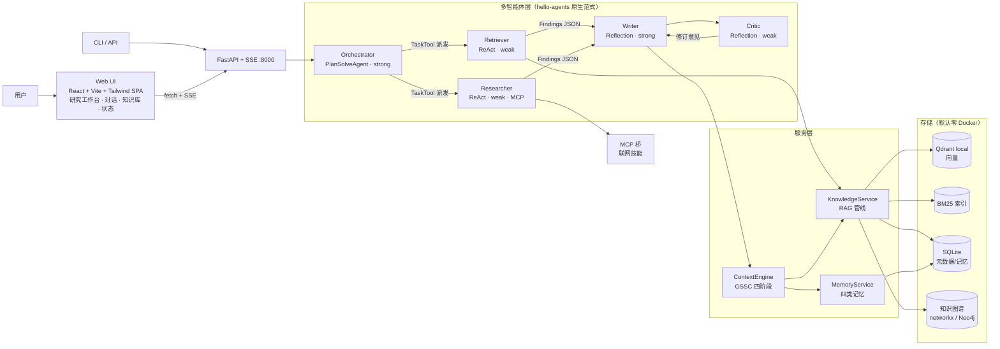
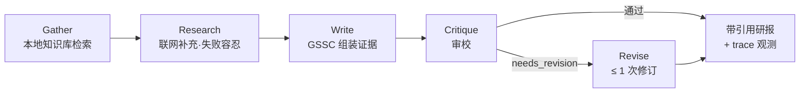

<div align="center">

# Cortex

**基于多智能体协作的个人知识管理与研究助手**

RAG 知识库 · 四类长期记忆 · GSSC 上下文工程 · 可核验引用的研究报告 · 三层评测

[](https://github.com/EthyleneC2H4/Cortex/actions/workflows/ci.yml)


</div>

---

## 这是什么

Cortex 构建在 [Hello-Agents](https://github.com/jjyaoao/HelloAgents) 框架（Datawhale《从零开始构建智能体》配套框架，v1.0.0）之上，把散落的本地文档变成可检索、可问答、可引用的私有知识库，再由五个角色的智能体协作产出**每条引用都可核验**的研究报告，并通过 FastAPI + SSE 对外提供流式服务。

核心设计原则：

- **确定性优先** —— 研究任务走固定流水线（可评测、可复现），开放探索才交给自主规划；阶段间以结构化 Findings JSON 交接，而非自由对话。
- **双档 LLM 成本模型** —— 强模型只做规划与写作，路由/检索/摘要/审校/打分全部用弱模型。
- **韧性内建** —— 阶段级看门狗、注册表自愈、宽容解析、软降级：任何外部依赖（配额、网络、解析）失效都有占位路径，流水线不断。
- **引用可核验** —— 报告中的每条引用都带知识库片段 ID，`citation_verify` 工具逐条做蕴含核验；无法核验时报告显式声明"待验证"并下调置信度。

## 架构总览



**研究流水线**（`mode=pipeline`，确定性路径）：



每个阶段都有：独立工具可见性（角色最小权限）· 墙钟看门狗（超时产出占位并自愈，trace 记录 `timed_out`）· 结构化 Findings 交接。

## 核心特性

| 领域 | 实现 |
|---|---|
| 📥 **摄取** | MarkItDown 解析（md/pdf/docx/pptx…）→ 512/64 token 分块（标题栈感知，代码块/表格原子）→ 本地 `bge-small-zh-v1.5` 嵌入 |
| 🔍 **检索** | 向量 ∪ BM25(CJK bigram) 双路召回 → RRF（k=60）融合；复杂查询自动升级为多查询扩展（MQE×3）+ HyDE 并行扇出；三带分类（answer / uncertain / 拒答） |
| 🧠 **记忆** | working / episodic / semantic / procedural 四类；加权评分（0.6×相似 + 0.25×重要 + 0.15×新近）；情景→语义巩固与三种软遗忘策略 |
| 🪟 **上下文工程** | GSSC（Get–Select–Structure–Compress）：类型化 token 配额、硬预算（窗口×0.7）、弱模型滚动压缩历史 |
| 🔐 **工具权限** | 共享 ToolRegistry + 派发期角色过滤（filters.py 单一事实来源）；子代理只看到其角色允许的工具 |
| 📑 **引用核验** | 引用 ID 归一化（五种拼写形态）→ `citation_verify` 蕴含判定 → 无法核验时报告显式披露 |
| 📊 **评测** | BFCL 式工具调用（AST 等价匹配）· GAIA 式任务达成（分级 QEM）· LLM-as-Judge（win-rate + κ 校准）；30 条冻结集 + 按条目断点续跑 + 消融开关 |
| 🌐 **服务化** | FastAPI + SSE：`POST /research`（结构化阶段进度流式 + 报告落盘）、`POST /chat/stream`、文档管理端点；X-API-Key 鉴权；可直接托管前端生产构建 |
| 🖥️ **Web UI** | React 19 + Vite + Tailwind v4 四页单页应用：研究工作台（五阶段实时计时/看门狗降级可见/报告下载）、智能对话（打字机渲染 + 会话恢复）、知识库管理（拖拽摄取 + 删除确认）、系统状态；暖色双主题、引用 chip 点击复制、完整键盘与无障碍支持 |
| 🔌 **协议** | MCP-first 联网（技能桥 + 工具桥）；A2A 委派端点；不可用时软降级为仅知识库 + 拒答带 |

## 快速开始

```bash
git clone https://github.com/EthyleneC2H4/Cortex.git
cd Cortex/cortex-app

python3 -m venv .venv && source .venv/bin/activate
pip install -e ".[dev]"
cp .env.example .env              # 填入 LLM_API_KEY（OpenRouter 兼容端点均可）
python -m cortex.prewarm          # 一次性：解析模型 id / 预热 tiktoken / 下载嵌入模型
```

> 密钥只放 `.env`（已 gitignore）。默认**零 Docker**：Qdrant 本地模式 + networkx 图 + SQLite；
> 需要生产存储时设 `CORTEX_STORE_MODE=docker` 并 `docker compose up -d`（Qdrant + Neo4j）。

### 基本用法

```bash
# 摄取文档入知识库
python -m cortex.app --ingest knowledge_base/samples/sample-hybrid-retrieval.md

# 生成带引用的研究报告（pipeline=确定性流水线 / explore=自主规划探索）
python -m cortex.app --research "对比检索增强生成中的混合检索策略" --mode pipeline

# CLI 多轮对话（带跨会话记忆）
python -m cortex.app --chat

# 评测需配置 LLM（数据集与指标逻辑有离线单测覆盖）
python -m cortex.eval.run --suite all [--no-rerank | --no-memory | --single-agent]
```

### HTTP API

```bash
python -m cortex.api.server &     # FastAPI + SSE @ :8000

curl -N -X POST localhost:8000/research \
  -H 'Content-Type: application/json' \
  -d '{"topic": "对比检索增强生成中的混合检索策略", "mode": "pipeline"}'

# 其余端点：POST /chat/stream（对话 SSE）、POST /ingest、POST /ingest-text、
# GET|DELETE /documents[/{doc_id}]、GET /session/{id}、GET /health
```

### Web UI

```bash
cd cortex-app/frontend
npm ci && npm run build           # 产出 frontend/dist（首次需 Node ≥ 20）
cd ..
python -m cortex.api.server       # 打开 http://127.0.0.1:8000 即是完整应用
```

- 生产态单命令：FastAPI 托管 `frontend/dist` 静态资源并兜底 SPA 子路由，无 Node 参与运行。
- 开发态热更新：`npm run dev`（Vite :5173 自动代理 API 到 :8000）。
- 四页：**研究工作台**（五阶段实时计时 + 看门狗降级标记 + 报告复制/下载，断连后结果已落盘）、**智能对话**（Enter 发送/Shift+Enter 换行、新对话重置）、**知识库**（拖拽上传/文本摄取/删除二次确认）、**系统状态**（服务健康轮询 + 知识库统计）。

## 评测结果

在 30 条冻结评测集（工具调用 10 / 任务达成 14 / 成对评判 6）上的实测结果：

| 套件 | 方法 | 结果 |
|---|---|---|
| 工具调用（BFCL 式） | AST 等价匹配（多调用集合匹配） | accuracy **0.90** |
| 任务达成（GAIA 式） | quasi-exact-match，L1/L2/L3 分级 | QEM **1.00**（5/5 · 5/5 · 4/4） |
| LLM-as-Judge | 成对比较 win-rate + κ 一致性校准 | agreement 0.333（κ=0.25） |

几点诚实的说明：

- 冻结集的定位是**回归检测**而非榜单刷分；评测运行器支持消融开关（`--no-rerank` / `--no-memory` / `--single-agent`）做对比实验。
- Judge 一致性偏低是**弱模型担任裁判的直接测量结果**——量化这一局限本身就是套件的设计目标之一，改进方向见下方"已知限制"。
- 完整报告示例见 [`docs/examples/`](docs/examples/)（含一次真实流水线运行产出的研报，注意其中"引用真实性披露"一节——系统在核验工具不可用时自动进入诚实降级模式）。

## 测试与质量

```bash
pytest -m unit                    # 全 mock 离线单测
pytest -m integration             # 本地真存储（sqlite + qdrant-local）
pytest -m "unit or integration"   # 后端离线门禁：333 passed
pytest -m e2e                     # live 测试，仅 HAS_LLM_KEY=1 时执行

# 前端门禁（cortex-app/frontend）
npx tsc -b && npx vitest run      # 类型检查 + 39 个组件/解析器测试
npm run build                     # 生产构建验证
```

- 三层测试分层（unit / integration / e2e），离线套件零网络零 Docker，嵌入用确定性 HashEmbedder、存储用 `tmp_path`。
- 前端 SSE 解析器为纯函数测试：中文多字节跨 chunk、CRLF、心跳注释、EOF 无尾换行等边界逐一覆盖。
- CI 在每次 push / PR 上跑双 job（Python 离线门禁 + Node 前端门禁，见 [`.github/workflows/ci.yml`](.github/workflows/ci.yml)）。
- 代码通过 ruff 默认规则集检查。

## 项目结构

```
Cortex/
├── README.md
├── docs/
│   ├── 代码实现规划文档.md            # 设计与阶段规划（权威参考）
│   └── examples/                     # 真实运行产出的研报与评测报告样例
└── cortex-app/
    ├── cortex/
    │   ├── agents/                   # 五角色构建、研究流水线、Findings 解析
    │   ├── tools/                    # note/knowledge/memory/citation/mcp/a2a 工具 + 角色过滤器
    │   ├── services/
    │   │   ├── knowledge/            # 分块/嵌入/向量库/BM25/图谱/检索/问答
    │   │   ├── memory/               # 四类记忆/评分/巩固/遗忘/异步写队列
    │   │   └── protocol/             # MCP 客户端管理、A2A 服务端/客户端
    │   ├── context/engine.py         # GSSC 上下文引擎
    │   ├── eval/                     # bfcl/gaia/judge 套件 + 数据集 + 运行器
    │   ├── api/                      # FastAPI + SSE 服务
    │   └── llm/                      # 双档 LLM 工厂、模型解析、重试
    ├── skills/                       # 联网技能（web-search / web-reader，MIT）
    ├── frontend/                     # Web UI：React 19 + Vite + Tailwind v4 SPA
    │   └── src/{api,hooks,components,pages,lib,context}/
    ├── knowledge_base/samples/       # 样例语料
    ├── tests/                        # unit / integration / e2e 三层
    └── docker-compose.yml            # 可选：Qdrant + Neo4j
```

## 设计要点

几个在开发中反复验证过的关键决策（完整设计文档见 [`docs/代码实现规划文档.md`](docs/代码实现规划文档.md)）：

- **阶段看门狗 + 注册表自愈** —— LLM 供给不稳（限流/代理断流）时，单阶段挂死不应陪葬整条流水线。每阶段套墙钟上限，超时放弃守护线程、产出占位结果继续；被放弃线程来不及还原的注册表状态由装配期快照写回兜底。实战中两次自动恢复并完成全流程。
- **工具可见性依附于调用路径** —— 过滤不是代理的属性，而是派发路径的行为。所有流水线阶段统一走 `run_as_subagent` + 角色过滤器，测试桩内嵌过滤器断言，任何绕过路径都会让测试爆红。
- **LLM 输出按用户输入对待** —— Findings 解析四级防线：剥壳 → 平衡括号扫描 → 截断字段抢救 → 整体降级，每级触发可观测。
- **数据契约归一化下沉** —— 引用 ID 在存储格式与展示格式之间存在多种合法拼写，归一逻辑收敛到唯一函数，消费方一律先归一再查询；歧义输入显式失败而非猜测。

## 已知限制与路线图

| 现状 | 改进方向 |
|---|---|
| 弱模型 Judge 与人工金标一致性低（κ=0.25） | 引入强模型裁判或与规则指标加权混合；位置交换双评降方差 |
| 删除文档清除向量/BM25/元数据，但知识图谱历史关联暂不随删（上游缺口，UI 已提示） | 图谱按 doc_id 级联清理 |
| 对话会话保存在服务进程内存：重启即失、多标签共享同一上下文（UI 明示） | 会话外置存储（Redis 等）；「新对话」可手动重置 |
| 聊天为整轮返回（框架 `run()` 同步无 token 流），前端以打字机弥补感知延迟 | 接入框架 `arun_stream` 做 token 级流式 |
| 同一时刻仅允许一个研究任务（免费档限流保护，重复提交返回 409） | job store 排队 + 断线重连恢复 |
| 图谱抽取在弱模型下解析成功率有限（已软降级，不阻断摄取） | 改用 function-calling 式结构化抽取 |
| 评测集为 30 条冻结集（回归检测定位） | 随使用逐步扩充人工金标 |
| 免费档 LLM 下全流程延迟分钟级 | 付费档即消除；降级设施作为通用韧性层保留 |

## 致谢

- [Hello-Agents](https://github.com/jjyaoao/HelloAgents)（Datawhale《从零开始构建智能体》）—— 本项目的智能体框架与教程参考
- [BAAI](https://huggingface.co/BAAI) —— bge 系列中文嵌入模型
- [Qdrant](https://github.com/qdrant/qdrant-client)、[FastAPI](https://github.com/tiangolo/fastapi)、[MarkItDown](https://github.com/microsoft/markitdown)、[rank-bm25](https://github.com/dorianbrown/rank_bm25) 等优秀开源组件

## 许可证

本项目原创代码以 [MIT](LICENSE) 许可证发布。`cortex-app/skills/` 下的联网技能（web-search、web-reader）为第三方开源 Skills（MIT 许可证，Copyright (c) 2025 z-ai-web-dev-sdk Skills），各目录内保留原始 LICENSE 文件。运行时依赖的 hello-agents 框架不随本仓库分发。使用本项目时请留意上述区分。
