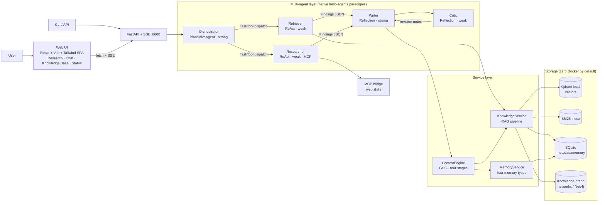
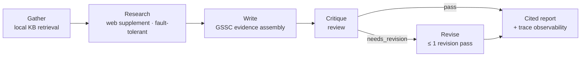

<div align="center">

# Cortex

**Multi-agent personal knowledge management & research assistant built on [hello-agents](https://github.com/jjyaoao/HelloAgents)** —
turn scattered local documents into a private knowledge base you can search, question and cite,
then have five role-specialized agents collaborate on research reports where **every citation is verifiable**, streamed end-to-end via FastAPI + SSE.

RAG knowledge base · Four-type long-term memory · GSSC context engineering · Verifiable citations · Three-tier evaluation

[](https://github.com/EthyleneC2H4/Cortex/actions/workflows/ci.yml)


[Features](#features) · [Architecture](#architecture) · [Quick Start](#quick-start) · [Evaluation](#evaluation-results) · [Project Layout](#project-layout) · [Known Limitations](#known-limitations--roadmap)

English · [简体中文](README.zh-CN.md)

</div>

---

## Why

Personal knowledge lives in scattered PDFs, course notes and slides. Querying it today means
either keyword search that misses every paraphrase, or a chatbot that answers fluently and cites
sources that don't exist. Neither gives you an answer you can trust enough to reuse.

Cortex attacks both failure modes on top of the
[Hello-Agents](https://github.com/jjyaoao/HelloAgents) framework (Datawhale's
《从零开始构建智能体》 companion framework, v1.0.0), **with zero framework-source changes**:
documents are ingested into a retrievable, quotable private knowledge base; five role-specialized
agents collaborate through a fixed research pipeline; and every citation in the resulting report
is checked by an entailment verifier before it reaches you. Everything streams over FastAPI + SSE.

Four design principles run through the whole system:

| Principle | What it means |
|---|---|
| **Determinism first** | Research runs a fixed pipeline (evaluable, reproducible); only open exploration gets autonomous planning. Stages hand off via structured Findings JSON, never free-form dialogue. |
| **Two-tier LLM cost model** | The strong model plans and writes; routing, retrieval, summarization, critique and scoring all run on the weak model. |
| **Resilience built in** | Stage-level watchdogs, registry self-healing, tolerant parsing, soft degradation — any external dependency (quota, network, parsing) failing yields a placeholder path, and the pipeline keeps going. |
| **Verifiable citations** | Every citation carries a knowledge-base chunk ID; `citation_verify` checks each one for entailment. Unverifiable claims are disclosed as "pending verification" with confidence lowered. |

## Features

- **Ingestion** — MarkItDown parsing (md/pdf/docx/pptx…) → 512/64-token chunking
  (heading-stack aware; code blocks and tables kept atomic) → local `bge-small-zh-v1.5` embeddings.
- **Retrieval** — vector ∪ BM25 (CJK bigram) dual recall fused with RRF (k=60); complex queries
  auto-upgrade to Multi-Query Expansion (MQE ×3) + HyDE parallel fan-out; three-band classification
  (answer / uncertain / refuse).
- **Memory** — working / episodic / semantic / procedural; weighted scoring
  (0.6 × similarity + 0.25 × importance + 0.15 × recency); episodic→semantic consolidation plus
  three soft-forgetting strategies.
- **Context engineering** — GSSC (Get–Select–Structure–Compress): typed token quotas,
  hard budget (window × 0.7), weak-model rolling compression of conversation history.
- **Tool permissions** — shared ToolRegistry + dispatch-time role filtering
  (`cortex/tools/filters.py` as the single source of truth); each subagent sees only its role's tools.
- **Citation verification** — citation-ID normalization (five spelling variants) →
  `citation_verify` entailment judgment → explicit disclosure in the report when unverifiable.
- **Evaluation** — BFCL-style tool calling (AST-equivalent matching) · GAIA-style task completion
  (graded quasi-exact-match) · LLM-as-Judge (win-rate + κ calibration); 30-item frozen set,
  per-item checkpoint resume, ablation switches.
- **Serving** — FastAPI + SSE: `POST /research` (structured stage-progress streaming + report
  persisted to disk), `POST /chat/stream`, document-management endpoints; X-API-Key auth;
  hosts the frontend production build directly.
- **Web UI** — React 19 + Vite + Tailwind v4 four-page SPA: Research Workbench (live five-stage
  timing, visible watchdog degradation, report copy/download), Chat (typewriter rendering +
  session restore), Knowledge Base (drag-and-drop ingest + delete confirmation), System Status;
  warm dual theme, click-to-copy citation chips, full keyboard & accessibility support.
- **Protocols** — MCP-first web access (skill bridge + tool bridge); A2A delegation endpoint;
  soft-degrades to knowledge-base-only + refusal band when unavailable.

## Architecture



**Research pipeline** (`mode=pipeline`, the deterministic path):



Every stage carries three guarantees:

1. **Least-privilege tool visibility** — each role sees only the tools its filter allows.
2. **Wall-clock watchdog** — a hung stage is abandoned at the timeout, emits a placeholder and
   self-heals (traces record `timed_out`) instead of sinking the pipeline.
3. **Structured handoff** — stages exchange typed Findings JSON, parsed by a four-level
   tolerant parser, never free-form text.

If the LLM supply degrades mid-run (rate limits, proxy dropouts), abandoned threads leave no
corrupted state: the registry snapshot taken at assembly time is written back as a fallback.
In practice the pipeline has twice recovered automatically and completed end-to-end.

## Quick Start

Requires Python ≥ 3.10. An OpenRouter-compatible LLM key is needed for live runs — build and
offline tests work without one.

```bash
git clone https://github.com/EthyleneC2H4/Cortex.git
cd Cortex/cortex-app

python3 -m venv .venv && source .venv/bin/activate
pip install -e ".[dev]"
cp .env.example .env              # fill in LLM_API_KEY (any OpenRouter-compatible endpoint)
python -m cortex.prewarm          # one-time: resolve model ids / warm tiktoken / download embedder
```

> [!NOTE]
> Keys go in `.env` only (gitignored). The default mode is **zero Docker**: Qdrant local mode +
> networkx graph + SQLite. For production stores set `CORTEX_STORE_MODE=docker` and run
> `docker compose up -d` (Qdrant + Neo4j).

### CLI usage

```bash
# Ingest a document into the knowledge base
python -m cortex.app --ingest knowledge_base/samples/sample-hybrid-retrieval.md

# Generate a cited research report (pipeline = deterministic / explore = autonomous planning)
python -m cortex.app --research "Compare hybrid retrieval strategies in RAG" --mode pipeline

# Multi-turn CLI chat with cross-session memory
python -m cortex.app --chat

# Evaluation needs an LLM key (datasets & metric logic covered by offline unit tests)
python -m cortex.eval.run --suite all [--no-rerank | --no-memory | --single-agent]
```

### HTTP API

```bash
python -m cortex.api.server &     # FastAPI + SSE @ :8000

curl -N -X POST localhost:8000/research \
  -H 'Content-Type: application/json' \
  -d '{"topic": "Compare hybrid retrieval strategies in RAG", "mode": "pipeline"}'

# Other endpoints: POST /chat/stream (chat SSE), POST /ingest, POST /ingest-text,
# GET|DELETE /documents[/{doc_id}], GET /session/{id}, GET /health
```

### Web UI

```bash
cd cortex-app/frontend
npm ci && npm run build           # outputs frontend/dist (Node ≥ 20 needed once)
cd ..
python -m cortex.api.server       # open http://127.0.0.1:8000 — that's the whole app
```

- Production mode is a single command: FastAPI serves `frontend/dist` static assets with SPA
  fallback — no Node involved at runtime.
- Development hot-reload: `npm run dev` (Vite :5173 proxies API calls to :8000).
- Four pages: **Research Workbench** (five-stage live timing, watchdog degradation marks,
  report copy/download — results survive disconnects), **Chat** (Enter sends / Shift+Enter
  newline, new-chat reset), **Knowledge Base** (drag-drop upload / text ingest / delete with
  confirmation), **System Status** (health polling + KB statistics).

## Evaluation Results

Measured on the 30-item frozen evaluation set (10 tool-calling / 14 task-completion /
6 pairwise-judgment items):

| Suite | Method | Result |
|---|---|---|
| Tool calling (BFCL-style) | AST-equivalent matching (multi-call set matching) | accuracy **0.90** |
| Task completion (GAIA-style) | quasi-exact-match, graded L1/L2/L3 | QEM **1.00** (5/5 · 5/5 · 4/4) |
| LLM-as-Judge | pairwise win-rate + κ agreement calibration | agreement 0.333 (κ=0.25) |

<details>
<summary><b>Honest caveats & methodology</b></summary>

1. The frozen set is positioned for **regression detection, not leaderboard chasing**; the eval
   runner ships ablation switches (`--no-rerank` / `--no-memory` / `--single-agent`) for
   controlled comparisons.
2. The low judge agreement is a **direct measurement of using a weak model as judge** —
   quantifying exactly this limitation is one of the suite's design goals; improvement paths are
   listed under Known Limitations below.
3. Full worked examples live in [`docs/examples/`](docs/examples/), including a real pipeline-run
   report — see its "citation authenticity disclosure" section, where the system automatically
   enters honest-degradation mode when the verification tool is unavailable.

</details>

## Testing & Quality

```bash
pytest -m unit                    # fully mocked offline unit tests
pytest -m integration             # real local storage (sqlite + qdrant-local)
pytest -m "unit or integration"   # backend offline gate: 333 passed
pytest -m e2e                     # live tests; runs only with HAS_LLM_KEY=1

# Frontend gate (cortex-app/frontend)
npx tsc -b && npx vitest run      # typecheck + 39 component/parser tests
npm run build                     # production build verification
```

- Three test layers (unit / integration / e2e); the offline suites need zero network and zero
  Docker — embeddings use a deterministic HashEmbedder and storage uses `tmp_path`.
- The frontend SSE parser is tested as pure functions: multi-byte CJK split across chunks, CRLF,
  heartbeat comments, EOF without trailing newline — edge cases covered one by one.
- CI runs two jobs on every push / PR (Python offline gate + Node frontend gate, see
  [`.github/workflows/ci.yml`](.github/workflows/ci.yml)).
- Code passes ruff's default rule set.

## Project Layout

```
Cortex/
├── README.md                     # English (default)
├── README.zh-CN.md               # Simplified Chinese
├── docs/
│   ├── 代码实现规划文档.md        # design & phase planning (authoritative reference)
│   └── examples/                 # sample research & eval reports from real runs
└── cortex-app/
    ├── cortex/
    │   ├── agents/               # five-role builders, research pipeline, Findings parsing
    │   ├── tools/                # note/knowledge/memory/citation/mcp/a2a tools + role filters
    │   ├── services/
    │   │   ├── knowledge/        # chunking/embedding/vector store/BM25/graph/retrieval/QA
    │   │   ├── memory/           # memory types/scoring/consolidation/forgetting/async writes
    │   │   └── protocol/         # MCP client management, A2A server/client
    │   ├── context/engine.py     # GSSC context engine
    │   ├── eval/                 # bfcl/gaia/judge suites + datasets + runner
    │   ├── api/                  # FastAPI + SSE server
    │   └── llm/                  # two-tier LLM factory, model resolution, retries
    ├── skills/                   # web skills (web-search / web-reader, MIT)
    ├── frontend/                 # Web UI: React 19 + Vite + Tailwind v4 SPA
    │   └── src/{api,hooks,components,pages,lib,context}/
    ├── knowledge_base/samples/   # sample corpus
    ├── tests/                    # unit / integration / e2e layers
    └── docker-compose.yml        # optional: Qdrant + Neo4j
```

## Design Notes

Key decisions validated repeatedly during development (full design doc:
[`docs/代码实现规划文档.md`](docs/代码实现规划文档.md)):

- **Stage watchdog + registry self-healing** — LLM supply is unstable (rate limits, proxy
  dropouts); a single hung stage must not sink the whole pipeline. Each stage gets a wall-clock
  cap; on timeout the worker thread is abandoned, a placeholder result is produced and the
  pipeline continues. Registry state the abandoned thread failed to restore is written back from
  the assembly-time snapshot. Twice in production use this recovered automatically and finished
  the full flow.
- **Tool visibility rides the call path** — filtering is not an agent property but behavior of
  the dispatch path. All pipeline stages uniformly go through `run_as_subagent` + role filters;
  test stubs embed filter assertions, so any bypass turns tests red.
- **LLM output is treated as user input** — Findings parsing has a four-level defense:
  shell stripping → balanced-bracket scan → truncated-field rescue → wholesale fallback; every
  level fires observably.
- **Contract normalization sinks to one function** — citation IDs legitimately appear in several
  spellings across storage and display formats; normalization converges into a single function,
  every consumer normalizes before querying, and ambiguous input fails explicitly instead of
  guessing.

## Known Limitations & Roadmap

| Current state | Improvement direction |
|---|---|
| Weak-model judge agrees poorly with human gold (κ=0.25) | Strong-model judge, or blend with rule metrics; position-swapped double judging to cut variance |
| Deleting a document clears vectors/BM25/metadata but historical graph edges remain (upstream gap; UI warns) | Cascade graph cleanup by doc_id |
| Chat sessions live in server process memory: lost on restart, tabs share one context (stated in UI) | External session store (Redis etc.); manual reset via "New chat" |
| Chat replies arrive whole-round (framework `run()` is synchronous, no token stream); frontend fakes streaming with a typewriter | Adopt framework `arun_stream` for token-level streaming |
| Only one research job at a time (free-tier rate-limit protection; duplicate submits get 409) | Job-store queueing + reconnect recovery |
| Graph extraction parse success rate is limited on the weak model (soft-degraded; ingestion unaffected) | Switch to function-calling-style structured extraction |
| Eval set is a 30-item frozen set (regression-detection positioning) | Grow human-labeled gold set gradually with use |
| Minute-level latency for the full pipeline on free-tier LLMs | Eliminated on paid tiers; degradation machinery stays as a general resilience layer |

## Acknowledgments

- [Hello-Agents](https://github.com/jjyaoao/HelloAgents) (Datawhale《从零开始构建智能体》) —
  the agent framework and tutorial reference this project builds on
- [BAAI](https://huggingface.co/BAAI) — the bge family of Chinese embedding models
- [Qdrant](https://github.com/qdrant/qdrant-client), [FastAPI](https://github.com/tiangolo/fastapi),
  [MarkItDown](https://github.com/microsoft/markitdown),
  [rank-bm25](https://github.com/dorianbrown/rank_bm25) and other excellent open-source components

## License

Original code released under the [MIT](LICENSE) license. The web skills under `cortex-app/skills/`
(web-search, web-reader) are third-party open-source Skills (MIT license, Copyright (c) 2025
z-ai-web-dev-sdk Skills) with their original LICENSE files retained in each directory. The
hello-agents framework is a runtime dependency and is not distributed with this repository.
Please mind these distinctions when using this project.
